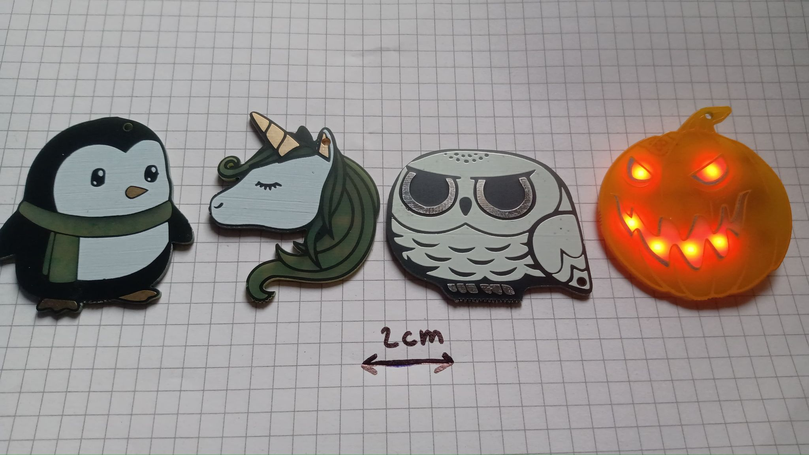

# 🦉 PCB Badges

**Odznaky, ktoré sú samy plošnými spojmi: tučniak, jednorožec, sova a svietiaca tekvica z JLCPCB.**

  

> **Rok realizácie:** 2020 · **Tagy:** `pcb` `pcb-art` `badge` `gerber` `jlcpcb` `led` `hardware` `electronics` `halloween`

## O projekte

Zbierka ozdobných odznakov vyrobených priamo z dosiek plošných spojov. Tvar, farby aj kresba sú tvorené vrstvami PCB (medenými plochami, nepájivou maskou a potlačou), preto ich netreba maľovať. Vľavo na fotke je tučniak, vedľa jednorožec, sova a vpravo **tekvica s LED diódami**, ktorá po pripojení napájania svieti ako Halloweenska dekorácia. Mierka na fotke je 2 cm.

## Obsah repozitára

| Súbor | Čo to je |
|---|---|
| `Gerber_Jack_O_Lanter.zip` | výrobné dáta (Gerber) pre svietiacu tekvicu |
| `Gerber_owl.zip` | výrobné dáta (Gerber) pre sovu |
| `all.jpg`, `owl.jpg`, `unicorn.jpg`, `Jack_o_lanter.jpg` | fotografie hotových kusov |

## Ako si ich dať vyrobiť

1. Na stránke výrobcu (napr. [JLCPCB](https://jlcpcb.com/)) nahrajte Gerber súbor z ZIP archívu.
2. Zvoľte parametre dosky (hrúbka, farba masky) podľa vzhľadu, aký chcete dosiahnuť.
3. Pri verzii s LED osaďte diódy a pripojte malý zdroj napájania.

## Poďakovanie

Veľká vďaka **JLCPCB** za skvelo vyrobené odznaky. 🙏

## Autor

**Vratislav Režo** ([@VRDragon](https://github.com/VRDragon))
